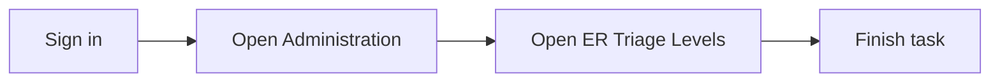

## What you will do

Use **ER Triage Levels** in **Administration** for everyday hospital tasks. A full walkthrough with screenshots will appear here after documentation capture runs.

## Before you start

- You are signed in to Medora.
- Your hospital is selected.
- Your supervisor gave you access to this screen.

## Steps

1. Open **Administration** from the home menu.
2. Open **ER Triage Levels**.
3. Follow the on-screen forms and save when you are done.

## Quick map

## If something goes wrong

- **Cannot open this screen:** ask your hospital administrator to add this page to your user group.
- **Empty list or missing patient:** select a patient visit first, then return to this screen.

## Legal

Follow your hospital privacy policy when you view or enter patient information.
