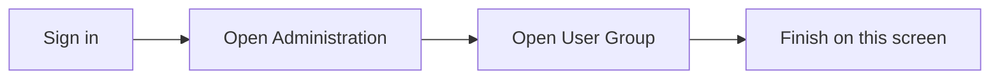

## What this screen is for

**User Group** is where you record and review work in **Administration**. This guide shows the screen and what to tap or click, step by step.

## Before you start

- You are signed in to Medora.
- Your hospital is selected in the top bar.

## Quick map

## Walkthrough

### Step 1: Open the screen

Sign in with your hospital account (for docs capture we use the seed admin from `.env`).

Select **Testing Hospital 1** in the hospital selector if prompted.

In the left **module bar**, click the **Administration** module icon.

On the Administration home screen, open **User Group**.

The screenshot includes the **top bar**, **module strip**, and work area at **1920x1080** (unless overridden).

*User Group list (1920x1080)*

### Step 2: Edit a row

Click the **edit** (pencil) icon on a row to change an existing record.

*Edit form*

### Step 3: Grant page actions

Click the **list** icon on a row to open **Manage page access**. The matrix lists every module, the pages inside it, and a column per action (**View**, **Create**, **Edit**, **Delete**, plus **Approve**, **Cancel**, **Issue**, **Receive**, **Print**, **Export**, **Upload** on the pages that have them). A page shows a dash for an action it does not offer.

- Tick the module header to allow every action on every page in that module.
- Tick an action header inside a module to allow that one action across the module.
- Tick a page name to allow all of that page's actions.
- **View** is granted automatically with any other action, and clearing **View** clears the rest of the page.

Saving replaces the group's grants immediately; staff in that group pick up the change on their next request. Only the hospital owner, a system administrator, or an admin team member can change access rights.

## If something goes wrong

- **Blank screen:** run `npm run db:seed:demo:docs` for Testing Hospital 1, then open the sub-tab under the section (for example Document Type under Document Master).
- **Cannot save:** check required fields marked with a red star.
- **A button is missing on a page:** the group has no grant for that action. Re-open **Manage page access** and tick it.
- **A staff member sees "Missing … permission"** when saving: the group has **View** but not **Create**/**Edit**/**Delete** for that page. The server rejects the write even if the button was visible.

## Legal

Only open patient information when your job requires it. Follow your hospital privacy rules.
