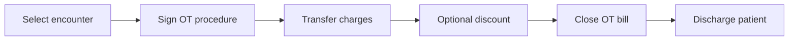

## What you will do

Use **OT Billing** to move completed Operation Theatre charges onto a bill, apply a discount if approved, close the OT bill and discharge the patient. The page follows the OT workflow:

1. The OT case reaches **Post-Op**.
2. The surgeon signs the OT procedure note on this page.
3. Charges are transferred to the OT bill.
4. The OT bill is closed.
5. The patient can be discharged (the discharge summary must also be signed).

## Before you start

- You are signed in to Medora with access to **Billing → OT Billing**.
- The hospital is selected.
- The patient has an encounter with a completed OT case (status **Post-Op**).
- The discharge summary is prepared if you intend to discharge the patient.

## Steps

1. Select the patient encounter from the encounter bar at the top of the page.
2. Review the workflow steps and any blocking reasons shown on screen.
3. For each completed OT case without a signed note, choose **Sign procedure**, enter the procedure performed and operative findings, then choose **Sign & save**.
4. Choose **Transfer charges to bill**. The bill is created with one line per completed OT procedure, priced from the branch service tariff.
5. If a discount applies, choose **Discount**, select percentage or fixed amount, and apply it.
6. Choose **Close OT bill** once all completed procedures are billed and signed.
7. Choose **Discharge patient** when the bill is closed. If discharge is blocked, confirm the discharge summary is signed.

## Rules and safeguards

- A procedure can be signed only after the OT case is **Post-Op**.
- Charges cannot be transferred until every completed OT procedure has a signed note.
- An empty bill cannot be closed, and a closed bill cannot be edited.
- The OT bill must be closed before the admission can be discharged.
- Aborted OT cases do not create billable lines.

## Quick map

## If something goes wrong

- **Cannot open this screen:** ask your hospital administrator to add **OT Billing** to your user group.
- **No completed procedure:** update the OT case to **Post-Op** first.
- **Transfer is disabled:** sign the remaining OT procedures.
- **Discharge is blocked:** close the OT bill and ensure the discharge summary is signed.
- **Amount is zero:** confirm the procedure has a service item and a branch service tariff.

## Legal

Follow your hospital privacy, billing and discharge policies. Do not alter charges or discharge a patient without the required clinical authorization.
