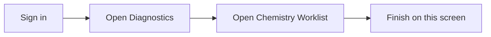

## What this screen is for

**Chemistry Worklist** is where you record and review work in **Diagnostics**. This guide shows the screen and what to tap or click, step by step.

## Before you start

- You are signed in to Medora.
- Your hospital is selected in the top bar.

## Quick map

## Walkthrough

_Screenshots could not be captured. Run `npm run db:seed:docs-demo`, start the dev server, then re-run docs capture._

## If something goes wrong

- **Blank screen:** run `npm run db:seed:docs-demo` for Testing Hospital 1, then open the sub-tab under the section (for example Document Type under Document Master).
- **Cannot save:** check required fields marked with a red star.

## Legal

Only open patient information when your job requires it. Follow your hospital privacy rules.
