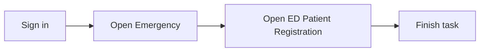

## What you will do

Use **ED Patient Registration** in **Emergency** for everyday hospital tasks. A full walkthrough with screenshots will appear here after documentation capture runs.

## Before you start

- You are signed in to Medora.
- Your hospital is selected.
- Your supervisor gave you access to this screen.

## Steps

1. Open **Emergency** from the home menu.
2. Open **ED Patient Registration**.
3. Select the patient (and branch from the top bar when applicable).
4. Optionally link an OPD visit as the source encounter.
5. Enter chief complaint, triage level, attending doctor, admission date/time, MLC flag, and remarks as needed.
6. Confirm two-factor authentication and submit. You are redirected to Nursing Workbench **Triage** for the new visit.

## Fields

| Area | Purpose |
|------|---------|
| Patient | Required; search and select before register. |
| Branch | Taken from the hospital branch selector (read-only on this screen). |
| OPD source visit | Optional; loads open OP billing context when linking from OPD. |
| Chief complaint | Required clinical reason for ED arrival. |
| Triage level | ED acuity at registration. |
| Doctor | Attending physician for the encounter. |
| Admission date/time | Defaults to now; adjust if back-entering arrival. |
| MLC | Marks medico-legal case; complete **MLC documentation** under Nursing Workbench when selected. |
| Remarks | Free-text registration notes. |

## Quick map

## If something goes wrong

- **Cannot open this screen:** ask your hospital administrator to add this page to your user group.
- **Empty list or missing patient:** select a patient before registering; OPD link requires a valid source visit id.

## Legal

Follow your hospital privacy policy when you view or enter patient information.
