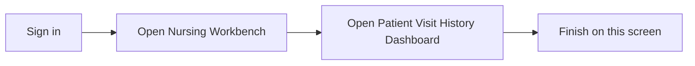

## What this screen is for

**Patient Visit History Dashboard** is where you record and review work in **Nursing Workbench**. This guide shows the screen and what to tap or click, step by step.

## Before you start

- You are signed in to Medora.
- Your hospital is selected in the top bar.

## Quick map

## Walkthrough

### Step 1: Open the screen

Sign in with your hospital account (for docs capture we use the seed admin from `.env`).

Select **Testing Hospital 1** in the hospital selector if prompted.

In the left **module bar**, click the **Nursing Workbench** module icon.

On the Nursing Workbench home screen, open **Patient Visit History Dashboard**.

Open the **Nursing OPD** section, then the **Patient Visit History Dashboard** tab.

The screenshot includes the **top bar**, **module strip**, and work area at **1920x1080** (unless overridden).

*Patient Visit History Dashboard overview (1920x1080)*

## If something goes wrong

- **Blank screen:** run `npm run db:seed:docs-demo` for Testing Hospital 1, then open the sub-tab under the section (for example Document Type under Document Master).
- **Cannot save:** check required fields marked with a red star.

## Legal

Only open patient information when your job requires it. Follow your hospital privacy rules.
