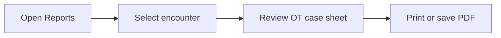

## What you will do

Use **Reports** in **Operation Theatre** to view and print an encounter-based OT case sheet. The case sheet collects the patient demographics, OT procedures, signed operative notes, handoff timeline, blood requisitions and OT billing in one printable report.

## Before you start

- You are signed in to Medora with access to **Operation Theatre → Reports**.
- The hospital is selected.
- You know which encounter you need. Use the encounter selector; a date range is not required.

## Steps

1. Open **Operation Theatre → Reports**.
2. Choose the encounter from the encounter selector at the top of the page.
3. Review the patient and encounter summary.
4. Review each OT case, including status, theatre, surgeon, procedure note and handoff times.
5. Review blood requisitions and OT billing for the encounter.
6. Choose **Print case sheet** to print or save the report as PDF.

## What the report contains

- Patient name, HRN, age/gender, encounter number, facility and contact number.
- Admission number, ward, bed, attending doctor and discharge time.
- Every OT case with status, date, theatre, surgeon, anaesthetist, service and priority.
- Provisional diagnosis, clinical notes, ward remarks and handoff timeline.
- Signed procedure note fields (procedure performed, findings, complications, specimens, post-op plan).
- Blood requisitions raised for the OT cases.
- OT bill number, subtotal, discount, total and close time.

## Quick map

## If something goes wrong

- **Cannot open this screen:** ask your hospital administrator to add **Reports** to your user group.
- **No case sheet:** confirm the selected encounter has an OT case.
- **Procedure note is missing:** the surgeon must sign the procedure in **Billing → OT Billing**.
- **Billing section is empty:** transfer OT charges from **Billing → OT Billing**.

## Legal

The OT case sheet contains protected health information. Print or share it only in line with your hospital privacy policy.
